<p align="center">
  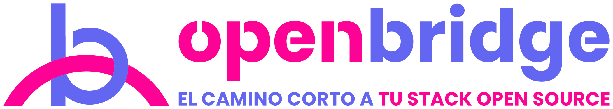
</p>

<p align="center">
  Catálogo inteligente de herramientas open source con asistente de arquitectura basado en IA (RAG).
</p>

<p align="center">
  <a href="https://openbridge-seven.vercel.app"></a>
  <a href="https://github.com/No-Country-simulation/S10-26-EQUIPO-19/releases"></a>
  
</p>

**Simulación Laboral Abierta · NoCountry** · Equipo **S10-26-equipo 19**
**Sector:** Developer Tools / Servicios de Consultoría Tech (B2B)

---

## 📋 Tabla de contenidos

- [Enlaces](#-enlaces)
- [El problema](#-el-problema)
- [Nuestra solución](#-nuestra-solución)
- [Funcionalidades](#-funcionalidades)
- [Capturas](#-capturas)
- [Arquitectura](#️-arquitectura)
- [Cómo funciona](#-cómo-funciona)
- [Entregables](#-entregables)
- [Stack tecnológico](#️-stack-tecnológico)
- [API](#-api)
- [Estructura del repositorio](#-estructura-del-repositorio)
- [Instalación y ejecución](#️-instalación-y-ejecución)
- [Despliegue](#-despliegue)
- [Calidad y seguridad](#-calidad-y-seguridad)
- [Flujo de trabajo](#-flujo-de-trabajo)
- [Identidad visual](#-identidad-visual)
- [Equipo](#-equipo)

---

## 🔗 Enlaces

| Recurso | Enlace |
|---|---|
| 🌐 Aplicación (producción) | [openbridge-seven.vercel.app](https://openbridge-seven.vercel.app) |
| ⚙️ API (producción) | [openbridge-rcv2.onrender.com/api/v1](https://openbridge-rcv2.onrender.com/health) |
| 🧪 Aplicación (desarrollo) | [openbridge-dev.vercel.app](https://openbridge-dev.vercel.app) |
| 📦 Versiones | [Releases](https://github.com/No-Country-simulation/S10-26-EQUIPO-19/releases) |
| 📄 Contrato de API | [`docs/api-contract.md`](docs/api-contract.md) |
| 🎨 Guía de estilo | [`docs/guia-de-estilo.md`](docs/guia-de-estilo.md) |

> ⏱️ La API usa el plan gratuito de Render: si estuvo inactiva, la primera consulta puede tardar cerca de un minuto en responder.

## 🎯 El problema

Una firma de desarrollo y consultoría tecnológica gestiona **más de 30 proyectos al año** para startups y empresas medianas, donde el *Time-to-Market* y los costos de infraestructura son clave.

Hoy sus arquitectos y líderes técnicos invierten **entre 15 y 20 horas por proyecto** investigando manualmente herramientas, microservicios y librerías open source. La información está dispersa en GitHub, listas *Awesome*, foros y Product Hunt, lo que provoca:

- Duplicación de esfuerzos entre proyectos.
- Adopción de librerías abandonadas.
- Pérdida de oportunidades para integrar alternativas gratuitas y autohospedadas (como Supabase, Keycloak o Meilisearch) desde el día uno.

## 💡 Nuestra solución

**OpenBridge** centraliza, categoriza y cura un catálogo de herramientas open source con ideas de integración estructuradas, y suma a **Toby**, un **asistente de arquitectura con IA (RAG)** que analiza la descripción de un negocio y recomienda un stack open source justificado, usando solo herramientas del catálogo revisadas a diario.

> **Ejemplo**
> *Entrada:* "Una plataforma para que clínicas agenden citas con pago en línea."
> *Salida:* un stack recomendado (agenda, pagos y notificaciones), con la justificación de cada herramienta, su licencia, su estado de mantenimiento, las conexiones entre ellas, un mapa de arquitectura y un docker-compose para levantarlas.

## ✨ Funcionalidades

### Obligatorias

| Módulo | Descripción |
|---|---|
| 📚 **Catálogo** | 159 herramientas en 25 categorías funcionales: Autenticación, Base de Datos y Backend, Pagos y Comercio, IA y LLM, Geolocalización y Logística, Analítica, entre otras. |
| 📄 **Ficha técnica** | Por herramienta: descripción, estrellas, forks, última actualización, licencia, lenguaje, issues abiertos, *health score* con su desglose y enlaces a la documentación oficial. |
| 🔌 **Ideas de integración** | Tipo de integración (REST, Docker, SDK, webhooks), disparadores, ejemplo de código para copiar, stack compatible y nivel de dificultad. |
| 🔍 **Buscador avanzado** | Búsqueda por texto y filtros por categoría, lenguaje, licencia, nivel de mantenimiento y estrellas mínimas, con orden por estrellas o actualización. |
| 🤖 **Asistente de arquitectura (RAG)** | Toby recibe la descripción de un producto y devuelve un stack justificado, con fuentes del catálogo, conexiones verificadas y preguntas sugeridas para seguir. |
| 🔄 **Pipeline de ingesta** | Proceso diario con GitHub Actions que consulta la API de GitHub, actualiza las métricas y recalcula el *health score* de cada herramienta. |

### Opcionales implementadas

| Funcionalidad | Descripción |
|---|---|
| 🗺️ **Mapa de arquitectura** | Diagrama interactivo del stack recomendado, con las conexiones entre herramientas. |
| 🐳 **Docker-compose de arranque** | Genera un archivo `docker-compose.yml` con las herramientas del stack, usando solo imágenes oficiales y sin secretos. |
| ⚠️ **Alertas de riesgo** | Avisos por licencias con obligaciones (AGPL, GPL), proyectos archivados o sin actividad reciente. |
| ⚖️ **Comparador** | Comparación lado a lado de 2 o 3 herramientas, con las métricas clave y la mejor opción destacada cuando son de la misma categoría. |
| 📝 **Descarga de la propuesta** | Exporta un ZIP con la recomendación del asistente en Markdown y, cuando el stack lo permite, el `docker-compose.yml` de arranque. |
| 🌓 **Modo claro y oscuro** | Respeta la preferencia del sistema y se puede cambiar en cualquier momento. |
| 💬 **Conversación guardada** | La última conversación con el asistente se guarda solo en el navegador del usuario. |

## 📸 Capturas

### Catálogo con buscador y filtros
<p align="center">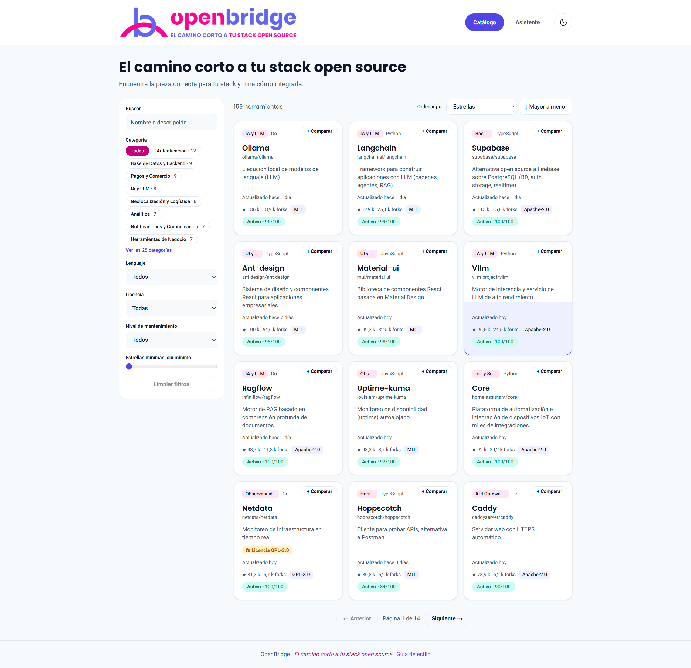</p>

### Ficha técnica con health score e ideas de integración
<p align="center">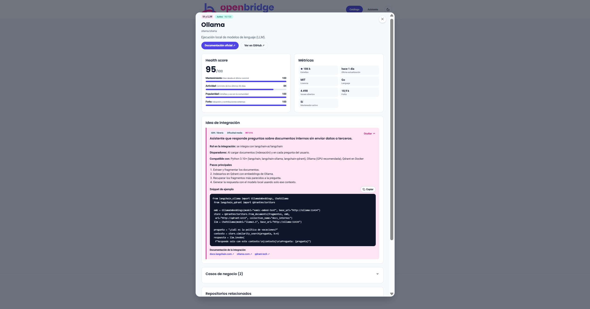</p>

### Asistente de arquitectura: stack recomendado y mapa
<p align="center">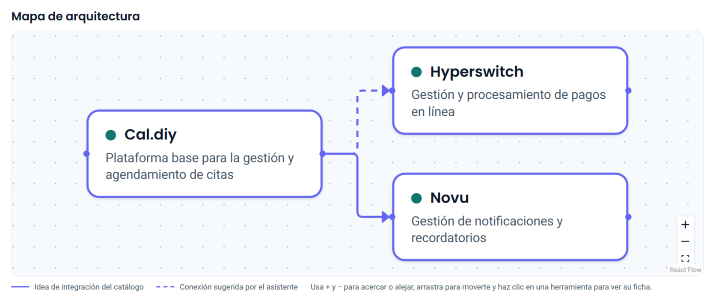</p>

<details>
<summary>Ver la respuesta completa del asistente (caso: clínicas que agendan citas con pago en línea)</summary>
<p align="center">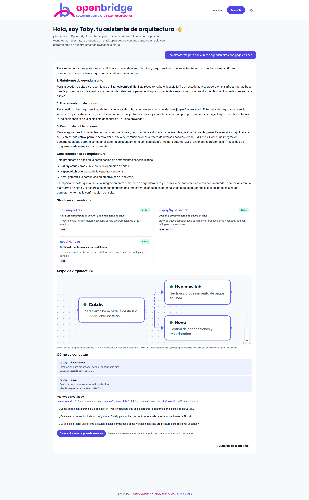</p>
</details>

### Comparador de herramientas
<p align="center">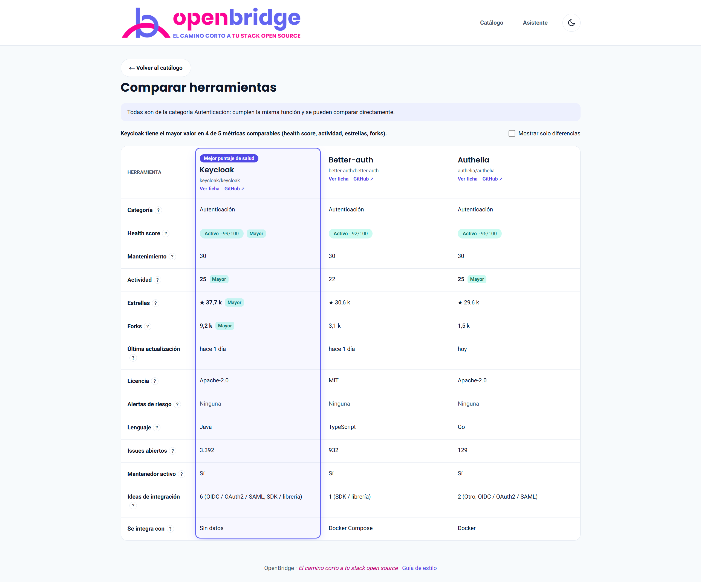</p>

### Modo oscuro y versión para celular
<p align="center">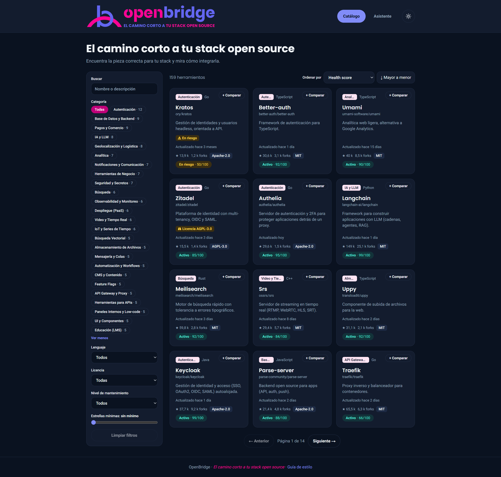</p>
<p align="center">
  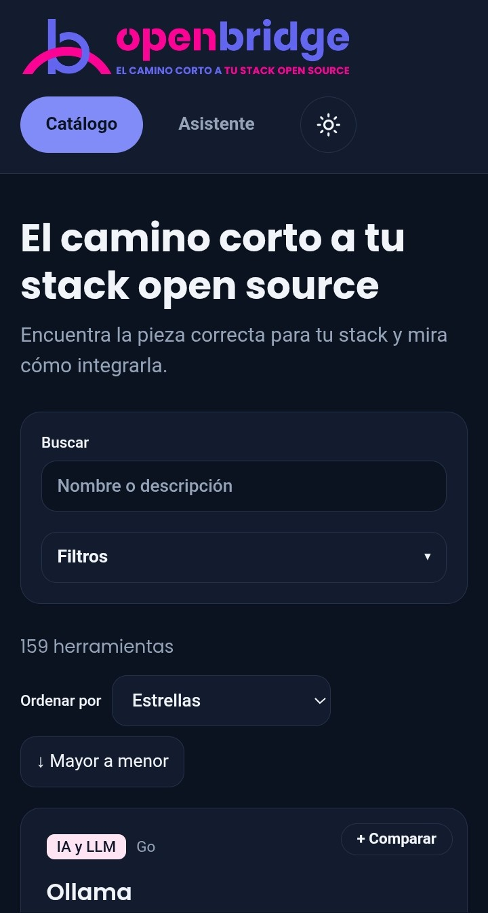
  &nbsp;&nbsp;
  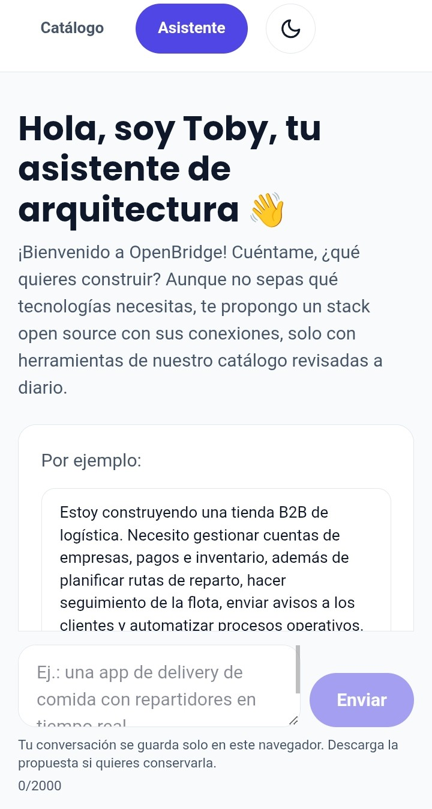
</p>

## 🏗️ Arquitectura

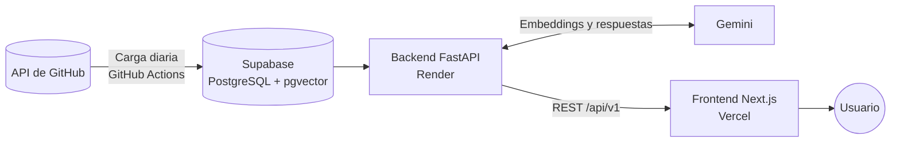

## 🧠 Cómo funciona

### Asistente de arquitectura (RAG)

1. **Entiende la necesidad:** analiza el mensaje y detecta requisitos como categoría, lenguaje o licencia. Los mensajes de seguimiento se interpretan con el contexto de la consulta anterior.
2. **Busca en el catálogo:** combina una búsqueda con filtros en la base de datos, una búsqueda semántica sobre los README de cada herramienta (embeddings en pgvector) y los casos de negocio de referencia.
3. **Arma la recomendación:** Gemini redacta la propuesta solo con las herramientas encontradas, así que no recomienda nada que no esté en el catálogo ni revisado.
4. **Responde con contexto:** stack, justificación, licencias, estado de mantenimiento, conexiones verificadas con las ideas de integración, fuentes y preguntas sugeridas.

Los saludos, la presentación de Toby y las consultas sobre herramientas que no están en el catálogo tienen respuestas fijas, sin llamar al modelo.

### Health score

Cada herramienta tiene un puntaje de 0 a 100, que se recalcula a diario y se puede ver desglosado en su ficha:

| Componente | Peso | Qué mide |
|---|---|---|
| Mantenimiento | 30 | Días desde el último commit en la rama principal (0 si el repositorio está archivado). |
| Actividad | 25 | Commits de los últimos 90 días. |
| Popularidad | 15 | Estrellas. |
| Forks | 10 | Adopción y contribuciones externas. |

Según su último commit, cada herramienta se clasifica como **Activa** (hasta 90 días), **En riesgo** (91 a 180 días) o **Abandonada** (más de 180 días o archivada).

## 📦 Entregables

- [x] Catálogo web interactivo y responsivo, con categorías, filtros y búsqueda por texto.
- [x] Asistente de arquitectura con IA (RAG).
- [x] Pipeline automatizado de ingesta desde la API de GitHub.
- [x] Base de datos poblada con **159 repositorios** open source (mínimo exigido: 100), **95 ideas de integración** y **22 casos de negocio**.

## 🛠️ Stack tecnológico

| Capa | Tecnologías |
|---|---|
| Frontend | Next.js 16 · React 19 · TypeScript · Tailwind CSS 4 · React Flow |
| Backend | FastAPI (Python) |
| Base de datos y búsqueda vectorial | Supabase (PostgreSQL + pgvector) |
| IA | Gemini: `gemini-3.1-flash-lite` (con `gemini-3.5-flash-lite` como respaldo) y `gemini-embedding-2` (768 dimensiones) |
| Datos | API REST de GitHub |
| Infraestructura | Vercel (frontend) · Render (backend) · GitHub Actions (carga diaria y keep-alive) |

## 🔌 API

Base: `https://openbridge-rcv2.onrender.com`. El detalle de cada endpoint está en el [contrato de API](docs/api-contract.md).

| Método | Ruta | Descripción |
|---|---|---|
| `GET` | `/health` | Estado del servicio. |
| `GET` | `/api/v1/categories` | Categorías del catálogo. |
| `GET` | `/api/v1/repositories` | Listado paginado y ordenable. |
| `GET` | `/api/v1/repositories/search` | Búsqueda por texto y filtros. |
| `GET` | `/api/v1/repositories/compare` | Comparación de 2 o 3 herramientas. |
| `GET` | `/api/v1/repositories/{id}` | Ficha técnica con ideas de integración. |
| `POST` | `/api/v1/assistant/chat` | Consulta al asistente de arquitectura. |
| `POST` | `/api/v1/compose` | Genera el docker-compose de un stack. |
| `GET` | `/github/repository/{owner}/{repo}` | Datos enriquecidos de un repositorio de GitHub. |
| `POST` | `/github/repositories/sync` | Sincronización del catálogo (protegida con `X-API-Key`). |

Las rutas de repositorios, asistente, compose y GitHub tienen límite de solicitudes por IP.

## 📁 Estructura del repositorio

```text
S10-26-EQUIPO-19/
├── .github/workflows/    # Carga diaria del catálogo y keep-alive del backend
├── app/                  # Backend (FastAPI)
│   ├── clients/          # Cliente de la API de GitHub
│   ├── core/             # Límite de solicitudes, seguridad del prompt e intenciones del asistente
│   ├── data/             # Catálogo, ideas de integración, casos de negocio y datos Docker
│   ├── orchestrator/     # Orquestador del asistente (análisis, contexto y compatibilidad)
│   ├── repositories/     # Acceso a datos
│   ├── routers/          # Endpoints por dominio
│   ├── schemas/          # Modelos de validación Pydantic
│   ├── scripts/          # Sincronización con GitHub y tareas de mantenimiento
│   ├── services/         # Búsqueda SQL y semántica, embeddings, Gemini y docker-compose
│   ├── database.py       # Cliente de Supabase
│   └── main.py           # Aplicación, CORS, cabeceras de seguridad y rutas
├── docs/                 # Contrato de API y guía de estilo
├── frontend/             # Interfaz web (Next.js + TypeScript + Tailwind CSS)
├── .env.example          # Plantilla de variables del backend (sin secretos)
├── requirements.txt      # Dependencias de Python
└── README.md
```

## ⚙️ Instalación y ejecución

### 📥 Clonar el repositorio

```bash
git clone https://github.com/No-Country-simulation/S10-26-EQUIPO-19.git
cd S10-26-EQUIPO-19
```

### 🖥️ Frontend

**Requisitos:** Node.js 20.9 o superior y npm.

```bash
cd frontend
npm install
cp .env.example .env.local   # en Windows (PowerShell): copy .env.example .env.local
npm run dev
```

Abre [http://localhost:3000](http://localhost:3000). Por defecto consulta la API desplegada; para trabajar sin conexión, usa `NEXT_PUBLIC_USE_MOCK=true` y se mostrarán datos de ejemplo.

Más detalles en [`frontend/README.md`](frontend/README.md).

### 🚀 Backend (FastAPI)

**Requisitos:** [Python 3.10+](https://www.python.org/) y Git.

#### 1. Crear y activar el entorno virtual

Desde la carpeta raíz del repositorio:

- **Windows (PowerShell):**
  ```powershell
  python -m venv venv
  .\venv\Scripts\Activate.ps1
  ```
  *(Si PowerShell restringe la ejecución de scripts, puedes habilitarla temporalmente con `Set-ExecutionPolicy -Scope Process -ExecutionPolicy Bypass`).*

- **Linux / macOS:**
  ```bash
  python3 -m venv venv
  source venv/bin/activate
  ```

#### 2. Instalar dependencias

```bash
pip install -r requirements.txt
```

#### 3. Configurar variables de entorno

```bash
cp .env.example .env   # en Windows (PowerShell): copy .env.example .env
```

> ⚠️ El archivo `.env` nunca debe subirse al repositorio. Las credenciales se comparten de forma privada dentro del equipo.

#### 4. Iniciar el servidor

```bash
uvicorn app.main:app --reload
```

La API queda disponible en `http://127.0.0.1:8000`.

#### 5. Verificar que funciona

- **Estado:** [http://127.0.0.1:8000/health](http://127.0.0.1:8000/health) debe responder:
  ```json
  {"status": "ok", "message": "El backend de OpenBridge está activo y funcionando"}
  ```
- **Documentación interactiva:** [http://127.0.0.1:8000/docs](http://127.0.0.1:8000/docs) (Swagger UI) y [http://127.0.0.1:8000/redoc](http://127.0.0.1:8000/redoc) (Redoc), disponibles solo fuera de producción.

---

## 🚀 Despliegue

| Componente | Plataforma | Producción (`main`) | Desarrollo (`dev`) |
|---|---|---|---|
| Frontend | Vercel | [openbridge-seven.vercel.app](https://openbridge-seven.vercel.app) | [openbridge-dev.vercel.app](https://openbridge-dev.vercel.app) |
| Backend | Render | [openbridge-rcv2.onrender.com](https://openbridge-rcv2.onrender.com/health) | [openbridgedev.onrender.com](https://openbridgedev.onrender.com/health) |

Ambas plataformas despliegan automáticamente cada cambio que se integra en su rama.

### ☁️ Backend en Render

El equipo eligió **[Render](https://render.com)** como Web Service para el backend por estas razones:

1. **Despliegue continuo:** se conecta con la rama del repositorio y compila y arranca la aplicación ante cada cambio integrado.
2. **Compatible con FastAPI y Uvicorn:** ejecuta aplicaciones asíncronas sin configurar servidores ni proxies propios.
3. **HTTPS administrado:** certificados TLS automáticos y protección en el borde con Cloudflare.
4. **Variables de entorno centralizadas:** los secretos se gestionan en la plataforma, nunca en el código.

**Configuración del servicio:**

- **Environment:** `Python 3`
- **Root Directory:** `./`
- **Build Command:** `pip install -r requirements.txt`
- **Start Command:** `uvicorn app.main:app --host 0.0.0.0 --port $PORT`
- **Auto-Deploy:** `Yes`

**Variables de entorno** (sin secretos reales en el repositorio):

| Variable | Descripción | Ejemplo |
|---|---|---|
| `SUPABASE_URL` | URL del proyecto de Supabase | `https://<proyecto>.supabase.co` |
| `SUPABASE_KEY` | Clave de servicio de Supabase | `<secreto>` |
| `GEMINI_API_KEY` | Clave de la API de Gemini (Google AI Studio) | `<secreto>` |
| `GH_TOKEN` | Token de GitHub de solo lectura, para la carga diaria y las consultas | `<secreto>` |
| `SYNC_API_KEY` | Clave que autoriza el endpoint de sincronización | `<secreto>` |
| `ENVIRONMENT` | `production` oculta `/docs`, `/redoc` y `/openapi.json` y desactiva los datos de ejemplo | `production` |
| `ALLOWED_ORIGINS` | Dominios autorizados para CORS, separados por coma | `https://openbridge-seven.vercel.app,http://localhost:3000` |
| `PORT` | Puerto HTTP (lo asigna Render) | `10000` |

### ▲ Frontend en Vercel

- **Root Directory:** `frontend`
- **Framework:** Next.js (detección automática)
- **Variables de entorno:**

| Variable | Descripción | Ejemplo |
|---|---|---|
| `NEXT_PUBLIC_API_URL` | URL base de la API | `https://openbridge-rcv2.onrender.com/api/v1` |
| `NEXT_PUBLIC_USE_MOCK` | `true` usa datos de ejemplo en lugar de la API | `false` |
| `NEXT_PUBLIC_ENABLE_COMPOSE` | `true` muestra el botón del docker-compose en el asistente | `true` |

### 🔄 Tareas automatizadas (GitHub Actions)

- **Carga diaria del catálogo (`github_sync.yml`):** todos los días a las 06:00 UTC consulta GitHub, actualiza las métricas en Supabase y recalcula el *health score*.
- **Keep-alive (`keep-alive.yml`):** cada 10 minutos consulta `/health` del backend de producción para evitar que el plan gratuito de Render lo suspenda por inactividad.

### ✅ Verificación

```bash
curl -f https://openbridge-rcv2.onrender.com/health
```

Respuesta esperada (HTTP 200):

```json
{"status": "ok", "message": "El backend de OpenBridge está activo y funcionando"}
```

## 🛡️ Calidad y seguridad

- **Pruebas por niveles (QA):** datos e ingesta (N1), API (N2), asistente RAG (N3) y plataforma integrada (N4), con matrices de casos y criterios de aceptación.
- **Pruebas de seguridad** en cada nivel y un pentest de la plataforma integrada.
- **Medidas aplicadas:**
  - Cabeceras de seguridad en backend y frontend (CSP, `X-Frame-Options`, `X-Content-Type-Options`, `Referrer-Policy`, HSTS).
  - CORS con lista blanca de dominios.
  - Límite de solicitudes por IP en las rutas de repositorios, asistente, compose y GitHub.
  - Validación de entradas y del largo de los mensajes del asistente.
  - Protección del asistente contra *prompt injection*.
  - Endpoint de sincronización protegido con clave.
  - Documentación interactiva deshabilitada en producción.
  - Enlaces externos validados.
  - Secretos solo en variables de entorno.

## 🔀 Flujo de trabajo

- **Ramas:** cada cambio se trabaja en una rama propia (`feat/…`, `fix/…`, `docs/…`) y entra por pull request a `dev`. Después de probarse en desarrollo, `dev` pasa a `main` (producción).
- **Integración:** pull requests con *merge commit*, revisados por el responsable de validar cada tarea.
- **Versiones:** cada entrega se publica como [release](https://github.com/No-Country-simulation/S10-26-EQUIPO-19/releases) con sus notas de cambios.
- **Gestión:** tablero de Trello con matriz RACI y estructura de desglose del trabajo (WBS).

## 🎨 Identidad visual

<p>
  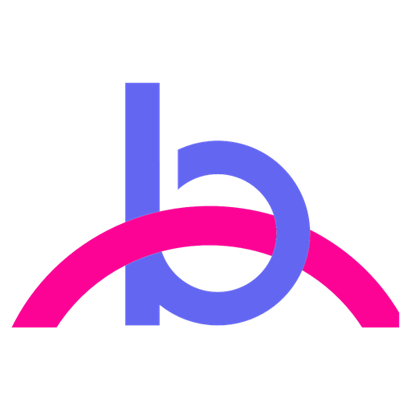
</p>

**Eslogan:** *El camino corto a tu stack open source*
**Tipografías:** Poppins (títulos) y Roboto (texto)

| Color | HEX | Uso |
|---|---|---|
|  Rosa | `#FC0395` | Acento: íconos, líneas e indicadores |
|  Índigo | `#6366F1` | Color principal de marca |
|  Cian | `#07BCEB` | Apoyo en gráficos y decoración |
|  Turquesa | `#1BDBC5` | Apoyo en gráficos y decoración |
|  Pizarra | `#64748B` | Neutro de marca |

La paleta completa, los tokens y las reglas de contraste están en la [guía de estilo](docs/guia-de-estilo.md).

---

## 👥 Equipo

| Integrante | Rol |
|---|---|
| Alexis Albarenga | Backend Developer |
| Demian Naon | Full Stack Developer |
| Francisco Aguilar García | QA Engineer |
| Gabriela Valdivia | QA Engineer |
| Martin Valdes | Ethical Hacker |
| Maria Fatima Soares Gomes | Project Manager |
| Melina Daniela Martinez | Backend Developer |
| Thiago Viana Santos | Software Engineer |

---

<p align="center">Hecho con 💙 por el <b>S10-26-equipo 19</b> · Simulación Laboral NoCountry · 2026</p>
