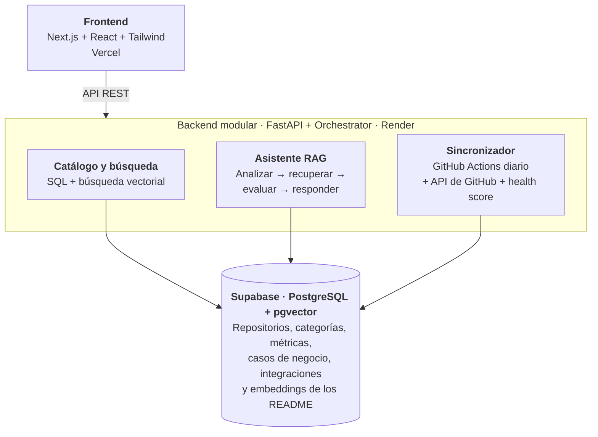
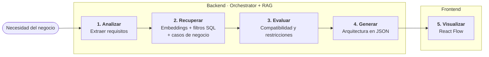

  

# OpenBridge - Arquitectura

**Arquitectura del Catálogo Open Source**
Resumen técnico · Frontend, backend, orquestación y RAG

---

## 1. Arquitectura general

Frontend y backend desacoplados, con un monolito modular en el backend. Permite separar responsabilidades sin la complejidad operativa de los microservicios.

| Capa | Componentes | Responsabilidad |
|---|---|---|
| **Frontend** | Next.js + React + Tailwind | Interfaz de usuario; se comunica con el backend mediante API REST. Desplegado en Vercel. |
| **Backend modular** | FastAPI + Orchestrator | Expone la API y coordina los módulos internos. Desplegado en Render, detrás de Cloudflare. |
| **Catálogo y búsqueda** | SQL + búsqueda vectorial | Consulta del catálogo con filtros exactos y búsqueda semántica. |
| **Asistente RAG** | Analizar → recuperar → evaluar → responder (con Gemini) | Genera arquitecturas recomendadas a partir de la necesidad del usuario. |
| **Sincronizador** | API de GitHub + GitHub Actions (todos los días a las 06:00 UTC) | Actualiza periódicamente los metadatos de los repositorios y calcula su health score. |
| **Base de datos** | Supabase (PostgreSQL + pgvector) | Repositorios, categorías, métricas, casos de negocio, integraciones y embeddings de los README. |

## 2. Stack tecnológico

| Capa | Elección recomendada |
|---|---|
| **Frontend** | Next.js 16, React 19, TypeScript y Tailwind CSS 4 |
| **Componentes y diagramas** | Componentes propios y React Flow (`@xyflow/react`) |
| **Backend** | Python + FastAPI; API REST |
| **Orquestación** | Orchestrator propio |
| **Datos y vectores** | Supabase: PostgreSQL + pgvector |
| **IA** | Gemini (Google AI Studio) para el asistente y para los embeddings, con un único modelo de embeddings (modelo de datos, regla 13): `gemini-3.1-flash-lite` para el asistente (con `gemini-3.5-flash-lite` como respaldo) y `gemini-embedding-2` a 768 dimensiones para los embeddings |
| **Sincronización** | API REST de GitHub + GitHub Actions (`github_sync.yml`, todos los días a las 06:00 UTC) |
| **Despliegue** | Vercel (frontend), Render detrás de Cloudflare (backend) y GitHub Actions (carga diaria, keep-alive del backend cada 10 minutos y pruebas automatizadas) |
| **Pruebas** | Pytest y Playwright (Smoke y E2E) |

## 3. Módulos del frontend

| Módulo | Responsabilidad |
|---|---|
| **Catálogo** | Listar tecnologías y mostrar tarjetas con descripción, estrellas, licencia, lenguaje y nivel de mantenimiento (health score). |
| **Búsqueda y filtros** | Buscar por texto, categoría, lenguaje, licencia, estrellas y estado de mantenimiento. |
| **Ficha del repositorio** | Mostrar metadatos, health score, casos de negocio, compatibilidad, ideas de integración y alternativas (otros repositorios de la misma categoría). |
| **Asistente** | Capturar la necesidad del usuario y mostrar la arquitectura recomendada y sus justificaciones. Guarda la última conversación (hasta 20 mensajes) solo en el navegador del usuario. |
| **Visualizador** | Dibujar componentes y conexiones de la arquitectura con React Flow a partir del bloque `architecture` de la respuesta del asistente (contrato de API, sección 3.1). Corresponde a la opcional 9.1. |
| **Comparador** | Comparar 2 o 3 herramientas lado a lado y destacar la de mejor health score cuando son de la misma categoría. Corresponde a la opcional 9.5. |
| **Alertas de riesgo** | Mostrar en la tarjeta, la ficha y el asistente los avisos de licencia y de mantenimiento que devuelve la API (campo `alerts`). Corresponde a la opcional 9.3. |
| **Docker-compose y descarga** | Mostrar el docker-compose de arranque del stack recomendado (opcional 9.2) y descargar la propuesta en un ZIP con el Markdown y el docker-compose (opcional 9.6). |
| **Tema** | Modo claro y oscuro, según la preferencia del sistema o la elección del usuario. Corresponde a la opcional 9.7. |
| **Cliente API** | Centralizar las llamadas HTTP al backend y los tipos de datos compartidos. |

## 4. Módulos del backend

| Módulo | Responsabilidad |
|---|---|
| **API / Routes** | Endpoints REST para repositorios, categorías, búsquedas, comparador, docker-compose y asistente. |
| **Repository Service** | Lógica de negocio del catálogo y acceso a datos mediante repositorios/ORM. |
| **GitHub Service** | Consultar GitHub y normalizar metadatos de los repositorios y calcular el health score según la fórmula acordada. |
| **Embedding Service** | Dividir el README de cada repositorio en fragmentos (hasta 500 tokens, con 75 de solapamiento) y generar sus vectores con `gemini-embedding-2` (768 dimensiones), en la tabla `embeddings` con `content_type = readme_chunk`. Solo se procesan los README cuyo `readme_hash` cambió. |
| **Search / Retriever** | Combinar búsqueda semántica con filtros SQL y la búsqueda de casos de negocio de referencia (`business_case_search_service.py`). |
| **Requirements Analyzer** | Convertir la descripción del negocio en requisitos técnicos (`RequirementsAnalyzer`). |
| **Compatibility Checker** | Validar restricciones, licencias y compatibilidad con datos disponibles (`CompatibilityEngine` y `EvidenceEvaluator`). |
| **Architecture Generator** | Producir componentes, conexiones y justificaciones en JSON estructurado (bloque `architecture` del contrato de API) con Gemini, a partir del contexto que arma `ContextBuilder`. |
| **Orchestrator** | Coordinar el análisis, la recuperación, la evaluación y la generación (`AssistantOrchestrator`). |
| **Risk Evaluator** | Calcular las alertas de riesgo por licencia y por mantenimiento de cada repositorio (opcional 9.3). |
| **Compose Generator** | Generar el docker-compose de arranque con imágenes oficiales de versión fija, sin secretos, y avisar si dos servicios usan el mismo puerto (opcional 9.2). |
| **Seguridad** | Límite de solicitudes por IP y global, validación de entradas, protección del asistente contra *prompt injection* y cabeceras de seguridad. |
| **Sync Scheduler** | Flujo de GitHub Actions que ejecuta a diario la sincronización con GitHub (tarea 2.9) y recalcula el health score. La actualización de los embeddings de los README no forma parte de esta carga diaria. |

## 5. Flujo del asistente (Orchestrator + RAG)

1. **Analizar:** interpretar el negocio y extraer requisitos. Los mensajes de seguimiento se interpretan con el contexto de la consulta anterior.
2. **Recuperar:** búsqueda semántica sobre los fragmentos de los README (embeddings), filtros SQL (licencia, lenguaje, categoría y mantenimiento) y casos de negocio de referencia.
3. **Evaluar:** comprobar compatibilidad y restricciones.
4. **Generar:** devolver arquitectura, conexiones y justificaciones en JSON (bloque `architecture` del contrato de API, sección 3.1).
5. **Visualizar:** el frontend representa la respuesta con React Flow.

Los saludos, la presentación del asistente (Toby) y las consultas sobre herramientas que no están en el catálogo tienen respuestas fijas, sin llamar al modelo.

> **Principio clave:** la IA propone y explica; el backend valida. Las integraciones sugeridas deben distinguirse de las verificadas. Cada conexión indica `verified: true` y su código (por ejemplo, INT-047) cuando corresponde a una idea de integración aprobada del catálogo, o `verified: false` cuando es una propuesta de la IA.

## 6. Datos y sincronización

Supabase (PostgreSQL) guarda repositorios, categorías, métricas, casos de negocio, relaciones e integraciones. pgvector permite búsqueda semántica sobre los fragmentos de los README; SQL aplica filtros exactos y ordenamientos por estrellas o fechas. Un flujo de GitHub Actions consulta GitHub todos los días a las 06:00 UTC, normaliza los datos, calcula el health score y actualiza la base. Los embeddings se regeneran con el servicio de README cuando cambia su contenido (`readme_hash`); ese proceso no forma parte de la carga diaria.

## 7. Orden de implementación

1. Catálogo, fichas, filtros y API REST.
2. Sincronización automática de metadatos desde GitHub.
3. Embeddings, búsqueda híbrida y asistente RAG.
4. Orquestador, validación y visualización de arquitecturas.

> **Decisión final:** Next.js + FastAPI + Supabase (PostgreSQL/pgvector) + Gemini + Orchestrator + RAG. Empezar como monolito modular; no hacen falta microservicios ni múltiples agentes autónomos para el MVP.
