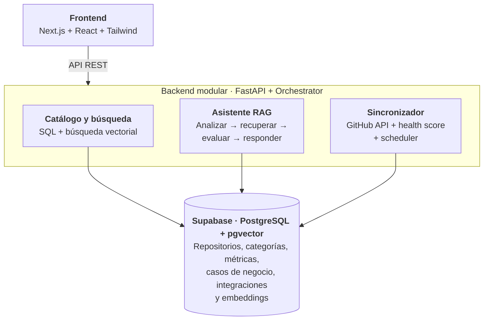
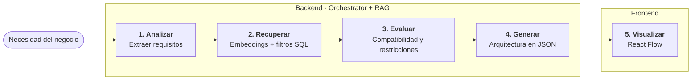

  

# OpenBridge - Arquitectura

**Arquitectura del Catálogo Open Source**
Resumen técnico · Frontend, backend, orquestación y RAG

---

## 1. Arquitectura general

Frontend y backend desacoplados, con un monolito modular en el backend. Permite separar responsabilidades sin la complejidad operativa de los microservicios.

| Capa | Componentes | Responsabilidad |
|---|---|---|
| **Frontend** | Next.js + React + Tailwind | Interfaz de usuario; se comunica con el backend mediante API REST. |
| **Backend modular** | FastAPI + Orchestrator | Expone la API y coordina los módulos internos. |
| **Catálogo y búsqueda** | SQL + búsqueda vectorial | Consulta del catálogo con filtros exactos y búsqueda semántica. |
| **Asistente RAG** | Analizar → recuperar → evaluar → responder (con Gemini) | Genera arquitecturas recomendadas a partir de la necesidad del usuario. |
| **Sincronizador** | GitHub API + scheduler | Actualiza periódicamente los metadatos de los repositorios y calcula su health score. |
| **Base de datos** | Supabase (PostgreSQL + pgvector) | Repositorios, categorías, métricas, casos de negocio, integraciones y embeddings. |

## 2. Stack tecnológico

| Capa | Elección recomendada |
|---|---|
| **Frontend** | Next.js, React, TypeScript y Tailwind CSS |
| **Componentes y diagramas** | shadcn/ui y React Flow |
| **Backend** | Python + FastAPI; API REST |
| **Orquestación** | Orchestrator propio; LangGraph opcional |
| **Datos y vectores** | Supabase: PostgreSQL + pgvector |
| **IA** | Gemini (Google AI Studio) para el asistente y para los embeddings, con un único modelo de embeddings (modelo de datos, regla 13) |
| **Sincronización** | GitHub REST/GraphQL API + cron/scheduler |

## 3. Módulos del frontend

| Módulo | Responsabilidad |
|---|---|
| **Catálogo** | Listar tecnologías y mostrar tarjetas con descripción, estrellas, licencia, lenguaje y nivel de mantenimiento (health score). |
| **Búsqueda y filtros** | Buscar por texto, categoría, lenguaje, licencia, estrellas y estado de mantenimiento. |
| **Ficha del repositorio** | Mostrar metadatos, health score, casos de negocio, compatibilidad, ideas de integración y alternativas (otros repositorios de la misma categoría). |
| **Asistente** | Capturar la necesidad del usuario y mostrar la arquitectura recomendada y sus justificaciones. |
| **Visualizador** | Dibujar componentes y conexiones de la arquitectura con React Flow a partir del bloque `architecture` de la respuesta del asistente (contrato de API, sección 3.1). Corresponde a la opcional 9.1. |
| **Cliente API** | Centralizar las llamadas HTTP al backend y los tipos de datos compartidos. |

## 4. Módulos del backend

| Módulo | Responsabilidad |
|---|---|
| **API / Routes** | Endpoints REST para repositorios, categorías, búsquedas y asistente. |
| **Repository Service** | Lógica de negocio del catálogo y acceso a datos mediante repositorios/ORM. |
| **GitHub Service** | Consultar GitHub y normalizar metadatos de los repositorios y calcular el health score según la fórmula acordada. |
| **Embedding Service** | Generar y actualizar vectores para cada repositorio (nombre, descripción, temas y lenguaje) y para las ideas de integración (tabla embeddings del modelo de datos), con el modelo de embeddings de Gemini. |
| **Search / Retriever** | Combinar búsqueda semántica con filtros SQL. |
| **Requirements Analyzer** | Convertir la descripción del negocio en requisitos técnicos. |
| **Compatibility Checker** | Validar restricciones, licencias y compatibilidad con datos disponibles. |
| **Architecture Generator** | Producir componentes, conexiones y justificaciones en JSON estructurado (bloque `architecture` del contrato de API). |
| **Orchestrator** | Coordinar el análisis, la recuperación, la evaluación y la generación. |
| **Sync Scheduler** | Ejecutar periódicamente la sincronización de GitHub (diariamente, tarea 2.9), recalcular el health score y actualizar embeddings cuando cambie el contenido. |

## 5. Flujo del asistente (Orchestrator + RAG)

1. **Analizar:** interpretar el negocio y extraer requisitos.
2. **Recuperar:** embeddings + filtros SQL (licencia, lenguaje, categoría y mantenimiento).
3. **Evaluar:** comprobar compatibilidad y restricciones.
4. **Generar:** devolver arquitectura, conexiones y justificaciones en JSON (bloque `architecture` del contrato de API, sección 3.1).
5. **Visualizar:** el frontend representa la respuesta con React Flow.

> **Principio clave:** la IA propone y explica; el backend valida. Las integraciones sugeridas deben distinguirse de las verificadas. Cada conexión indica `verified: true` y su código (por ejemplo, INT-047) cuando corresponde a una idea de integración aprobada del catálogo, o `verified: false` cuando es una propuesta de la IA.

## 6. Datos y sincronización

Supabase (PostgreSQL) guarda repositorios, categorías, métricas, casos de negocio, relaciones e integraciones. pgvector permite búsqueda semántica; SQL aplica filtros exactos y ordenamientos por estrellas o fechas. Un proceso programado consulta GitHub, normaliza los datos, calcula el health score y actualiza la base. Regenerar embeddings cuando cambie el contenido usado para generarlos.

## 7. Orden de implementación

1. Catálogo, fichas, filtros y API REST.
2. Sincronización automática de metadatos desde GitHub.
3. Embeddings, búsqueda híbrida y asistente RAG.
4. Orquestador, validación y visualización de arquitecturas.

> **Decisión final:** Next.js + FastAPI + Supabase (PostgreSQL/pgvector) + Gemini + Orchestrator + RAG.
