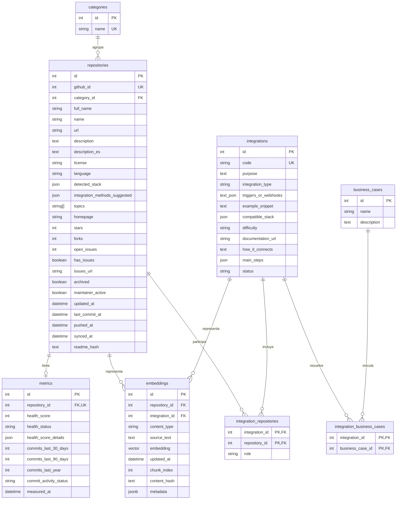

  

# Modelo de datos

# 1. Objetivo

Definir la estructura de datos para catalogar, evaluar y enriquecer repositorios open source, almacenar embeddings para búsquedas semánticas y representar ideas de integración entre repositorios.

El modelo contempla los datos obtenidos de GitHub, la categorización curada en el inventario de repositorios, las métricas actuales y las ideas de integración, tanto las iniciales como las que se agreguen más adelante.

# 2. Convención de nombres

- Las tablas y los campos se nombran en inglés y en snake_case. Las tablas van en plural (por ejemplo, repositories o business_cases).

- Los valores que ve el usuario, como estados, niveles de dificultad o tipos de integración, se guardan en español, igual que en el inventario.

# 3. Entidades

## 3.1 Repositorio (repositories)

Representa un repositorio open source aprobado en el inventario.

| **Campo**                         | **Tipo**        | **Descripción**                                                                                             |
|-----------------------------------|-----------------|-------------------------------------------------------------------------------------------------------------|
| `id`                            | Integer         | Identificador interno                                                                                       |
| `github_id`                     | Integer         | Identificador del repositorio en GitHub; único                                                              |
| `category_id`                   | Integer         | Categoría asignada desde el inventario                                                                      |
| `full_name`                     | String          | Propietario y nombre del repositorio                                                                        |
| `name`                          | String          | Nombre del repositorio                                                                                      |
| `url`                           | String          | URL del repositorio                                                                                         |
| `description`                   | Text / null     | Descripción original de GitHub; se usa para generar el embedding                                            |
| `description_es`                | Text / null     | Descripción curada en español; es la que se muestra en la ficha                                             |
| `license`                       | String / null   | Licencia declarada                                                                                          |
| `language`                      | String / null   | Lenguaje principal                                                                                          |
| `detected_stack`                | JSON            | Stack Tecnologico detectado                                                                                 |
| `integration_methods_suggested` | JSON            | Metodos sugeridos de integracion                                                                            |
| `topics`                        | Array\[String\] | Temas asociados                                                                                             |
| `homepage`                      | String / null   | Sitio web del proyecto                                                                                      |
| `stars`                         | Integer         | Cantidad de estrellas                                                                                       |
| `forks`                         | Integer         | Cantidad de forks                                                                                           |
| `open_issues`                   | Integer         | Cantidad de issues abiertos (la API de GitHub incluye en este número los pull requests abiertos)            |
| `has_issues`                    | Boolean         | Indica si el proyecto gestiona sus incidencias en GitHub Issues                                             |
| `issues_url`                    | String / null   | URL del sistema de incidencias cuando no es GitHub Issues (por ejemplo, Jira o Trac)                        |
| `archived`                      | Boolean         | Indica si el repositorio está archivado                                                                     |
| `maintainer_active`             | Boolean         | Indica si cumple el criterio de actividad                                                                   |
| `updated_at`                    | DateTime / null | Última modificación de los metadatos en GitHub; cambia también con nuevas estrellas u otros cambios menores |
| `readme_hash`                   | text            | Detectar si cambió el README completo del repositorio.                                                      |

## 3.2 Categoría (categories)

Clasifica los repositorios según la taxonomía definida en el inventario de repositorios.

| **Campo** | **Tipo** | **Descripción**               |
|-----------|----------|-------------------------------|
| `id`    | Integer  | Identificador de la categoría |
| `name`  | String   | Nombre de la categoría; único |

La categoría de cada repositorio proviene del inventario y no de una clasificación automática por nombre o descripción.

## 3.3 Métrica (metrics)

Almacena la última evaluación disponible de cada repositorio. No se conserva un historial de evaluaciones: cada nueva medición actualiza el registro existente.

| **Campo**                  | **Tipo**       | **Descripción**                                                                 |
|----------------------------|----------------|---------------------------------------------------------------------------------|
| `id`                     | Integer        | Identificador interno                                                           |
| `repository_id`          | Integer        | Repositorio evaluado; único                                                     |
| `health_score`           | Integer        | Puntuación global de 0 a 100                                                    |
| `health_status`          | String / null  | Activo, En riesgo o Abandonado; null si se desconoce la fecha del último commit |
| `health_score_details`   | JSON           | Desglose de los componentes del score                                           |
| `commits_last_30_days`   | Integer / null | Commits en los últimos 30 días                                                  |
| `commits_last_90_days`   | Integer / null | Commits en los últimos 90 días                                                  |
| `commits_last_year`      | Integer / null | Commits en el último año                                                        |
| `commit_activity_status` | String         | Estado de disponibilidad de la actividad de commits: available o unavailable    |
| `measured_at`            | DateTime       | Fecha y hora de la última medición                                              |

El health score considera mantenimiento, actividad de commits, popularidad según estrellas y reutilización aproximada según forks. Los repositorios archivados reciben una puntuación total de cero.

## 3.4 Caso de negocio (business_cases)

Representa una necesidad que puede resolverse mediante una integración entre repositorios. Los casos iniciales se importan desde la hoja «Casos de negocio» del inventario.

| **Campo**       | **Tipo**    | **Descripción**             |
|-----------------|-------------|-----------------------------|
| `id`          | Integer     | Identificador interno       |
| `name`        | String      | Nombre del caso de negocio  |
| `description` | Text / null | Descripción de la necesidad |

## 3.5 Idea de integración (integrations)

Representa una propuesta que combina repositorios para resolver uno o varios casos de negocio.

| **Campo**                | **Tipo**    | **Descripción**                                                                                                                                                     |
|--------------------------|-------------|---------------------------------------------------------------------------------------------------------------------------------------------------------------------|
| `id`                   | Integer     | Identificador interno                                                                                                                                               |
| `code`                 | String      | Código de la idea en el inventario (por ejemplo, INT-001); único                                                                                                    |
| `purpose`              | Text        | Propósito de la integración                                                                                                                                         |
| `integration_type`     | String      | Tipo de integración: API REST, SDK / librería, Docker, OIDC / OAuth2 / SAML, Webhooks / eventos, GraphQL, Plugin / extensión, Conector de base de datos, CLI u Otro |
| `triggers_or_webhooks` | Text / JSON | Disparadores o webhooks                                                                                                                                             |
| `example_snippet`      | Text        | Snippet de referencia                                                                                                                                               |
| `compatible_stack`     | JSON        | Tecnologías compatibles                                                                                                                                             |
| `difficulty`           | String      | Baja, Media o Alta                                                                                                                                                  |
| `documentation_url`    | String      | Enlace específico a la documentación oficial                                                                                                                        |
| `how_it_connects`      | Text        | Explicación de cómo se conectan los componentes                                                                                                                     |
| `main_steps`           | JSON        | Pasos principales de implementación                                                                                                                                 |
| `status`               | String      | Borrador, En revisión o Aprobada                                                                                                                                    |

Las ideas iniciales se importan desde la hoja «Ideas de integración» del inventario y permanecen en estado Borrador hasta completar su validación. Al importarlas, el stack compatible y los pasos numerados se convierten al formato JSON de sus campos.

## 3.6 Relaciones de las ideas de integración

Una idea puede combinar dos o más repositorios y relacionarse con uno o varios casos de negocio. Para representar estas relaciones se usan dos tablas intermedias.

### Idea y repositorio (integration_repositories)

| **Campo**          | **Tipo**      | **Descripción**                                  |
|--------------------|---------------|--------------------------------------------------|
| `integration_id` | Integer       | Referencia a la idea de integración              |
| `repository_id`  | Integer       | Referencia al repositorio involucrado            |
| `role`           | String / null | Función del repositorio dentro de la integración |

La combinación de integration_id y repository_id es única.

### Idea y caso de negocio (integration_business_cases)

| **Campo**            | **Tipo** | **Descripción**                     |
|----------------------|----------|-------------------------------------|
| `integration_id`   | Integer  | Referencia a la idea de integración |
| `business_case_id` | Integer  | Referencia al caso de negocio       |

La combinación de integration_id y business_case_id es única.

## 3.7 Embedding (embeddings)

Almacena las representaciones vectoriales de los contenidos que se usan en las búsquedas semánticas mediante pgvector.

| **Campo**          | **Tipo**       | **Descripción**                                                   |
|--------------------|----------------|-------------------------------------------------------------------|
| `id`             | Integer        | Identificador interno                                             |
| `repository_id`  | Integer / null | Repositorio asociado                                              |
| `integration_id` | Integer / null | Idea de integración asociada                                      |
| `content_type`   | String         | Tipo de contenido vectorizado                                     |
| `source_text`    | Text           | Texto usado para generar el embedding                             |
| `embedding`      | Vector         | Representación vectorial                                          |
| `updated_at`     | DateTime       | Última actualización del embedding                                |
| `chunk_index`    | integer        | Posición del fragmento dentro del README                          |
| `content_hash`   | text           | Detectar si el contenido del fragmento cambió                     |
| `metadata`       | jsonb          | Guardar información adicional, como sección y ruta de encabezados |

Cada embedding se asocia a un único contenido: un repositorio o una idea de integración.

El texto que se vectoriza de cada repositorio incluye su nombre (name), la descripción original de GitHub (description), sus temas (topics) y su lenguaje principal (language). Las ideas de integración pueden vectorizarse de forma independiente para permitir búsquedas semánticas de propuestas.

Los embeddings se generan con un modelo de embeddings de Gemini (Google AI Studio), y la dimensión del vector debe coincidir con la del modelo elegido. Para indexar con HNSW, pgvector admite vectores de hasta 2.000 dimensiones: si el modelo entrega más (por ejemplo, 3.072), se configura una dimensión de salida menor (768 o 1.536).

# 4. Relaciones entre entidades

- Una categoría agrupa varios repositorios.

- Cada repositorio pertenece a una categoría.

- Cada repositorio tiene un único registro de métricas actuales.

- Un repositorio puede participar en varias ideas de integración.

- Una idea puede incluir varios repositorios.

- Una idea puede resolver varios casos de negocio.

- Un repositorio o una idea de integración puede tener embeddings asociados.

# 5. Reglas de negocio

1.  El catálogo incluye únicamente repositorios aprobados en el inventario.

2.  La categoría y la descripción curada en español provienen del inventario.

3.  github_id identifica al repositorio en GitHub; id es el identificador interno.

4.  La ficha muestra last_commit_at como fecha de última actualización. pushed_at no se usa con ese fin porque incluye pushes a cualquier rama (por ejemplo, de bots de dependencias), y updated_at tampoco, porque cambia también con nuevas estrellas u otros cambios menores. synced_at registra la última sincronización del pipeline.

5.  La ficha muestra description_es. Si está vacía, muestra description.

6.  Las métricas se actualizan en un único registro por repositorio, sin historial.

7.  La actividad del mantenedor se determina según el criterio definido para el proyecto.

8.  Los repositorios archivados reciben una puntuación de salud de cero.

9.  Cuando has_issues es falso, el número de issues abiertos no refleja la actividad real del proyecto: no se usa para evaluarla, y la ficha enlaza a issues_url.

10. Las ideas de integración iniciales se importan como borradores, con su código del inventario.

11. Los snippets deben contrastarse con la documentación oficial antes de aprobar las propuestas.

12. Los secretos deben representarse mediante variables de entorno o marcadores, nunca con valores reales.

13. Los embeddings se generan con un único modelo y se almacenan mediante pgvector.

# 6. Alcance de implementación

Los datos del repositorio, las categorías y las métricas forman parte del catálogo. Las ideas iniciales se obtienen del inventario de repositorios y podrán complementarse con nuevas propuestas en versiones posteriores.

La persistencia en PostgreSQL, las relaciones entre entidades y la generación de embeddings se implementan de acuerdo con el alcance técnico acordado para el proyecto.

## 6.1 Restricciones en la base de datos

Al pasar del modelo a PostgreSQL se aplican estas restricciones:

- embeddings: exactamente una de las dos referencias (repository_id o integration_id) debe tener valor, validado con una restricción CHECK.

- metrics: repository_id es UNIQUE, para que exista una sola evaluación actual por repositorio.

- repositories: github_id es UNIQUE.

- categories: name es UNIQUE.

- integrations: code es UNIQUE.

- integration_repositories e integration_business_cases: la clave primaria es la combinación de sus dos referencias.

- embeddings: content_type es UNIQUE

- embeddings: chunk_index es UNIQUE

# 7. Diagrama entidad-relación

El diagrama muestra todas las tablas con sus campos y las relaciones entre ellas.

